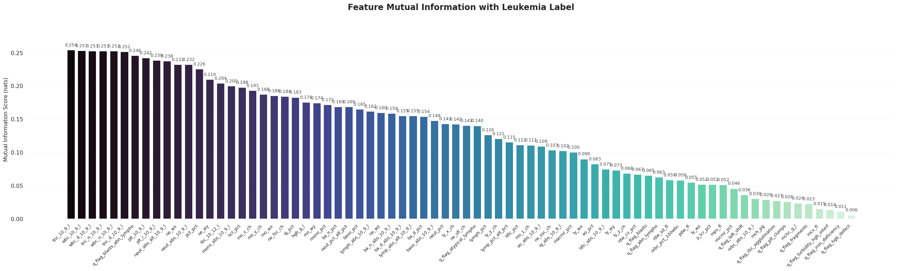
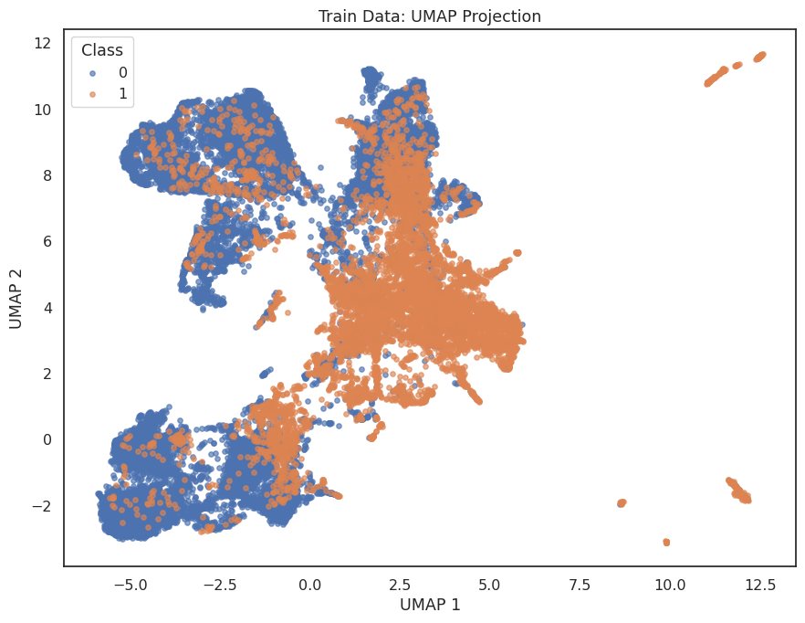
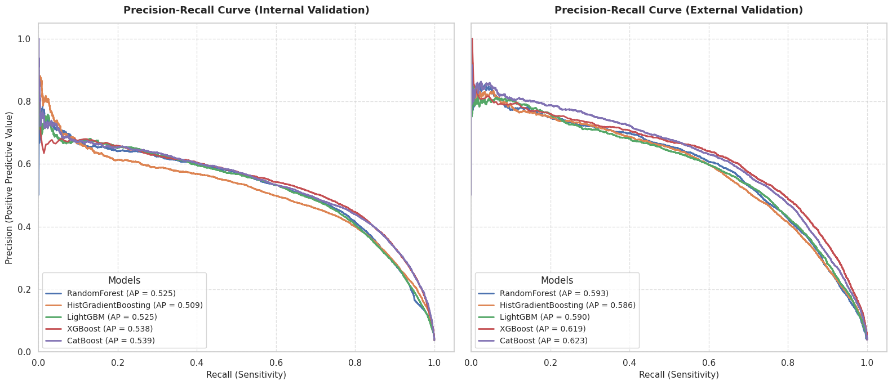
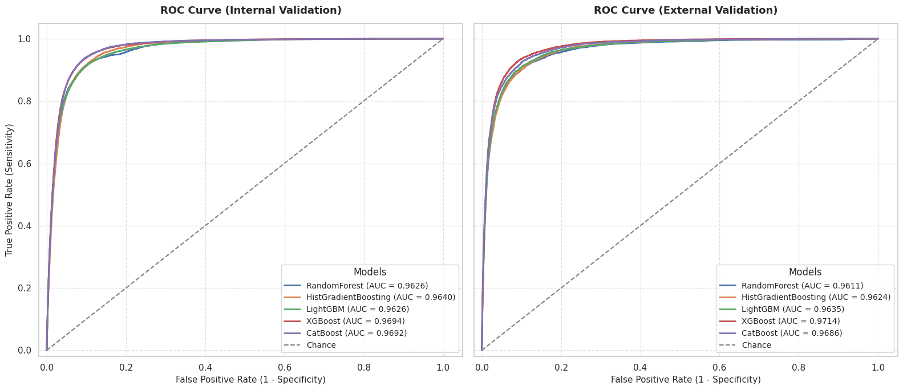
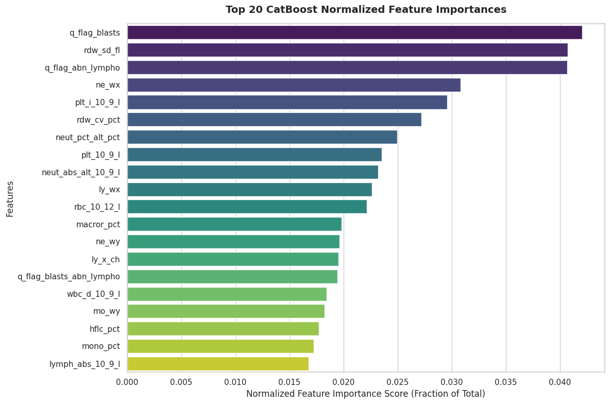
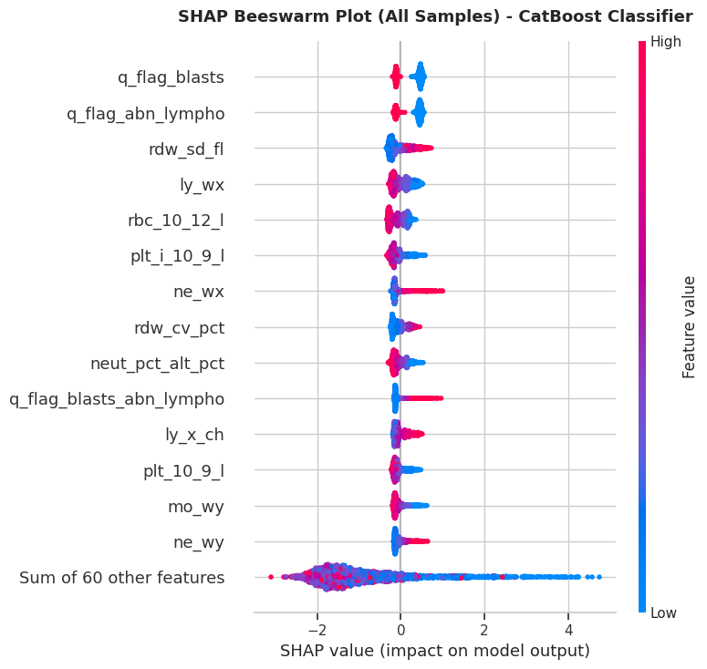

# LeukoAlert: Leukemia Screening from Routine Blood Counts

Baseline machine learning models that flag likely leukemia from automated hematology-analyzer output (complete blood count plus analyzer flags and scatter/fluorescence channels). This project is part of UTD Blood Cancer United's 2026 machine learning work.

The goal of this stage is a strong, honestly evaluated baseline: five tree-based classifiers, tuned on an internal validation set and then checked on unseen hospital sites and a later cohort.

## Dataset

- **Source:** [LeukoAlert, Mendeley Data v1](https://doi.org/10.17632/vc7kwnyppz.1), Shilong Liu (2026), CC BY 4.0. Study methods: <https://doi.org/10.1038/s41746-026-03016-3>.
- **Size:** 446,663 blood-test records, 74 numeric predictors, no missing values. 31 rows are exact duplicates on the predictors; they were left in.
- **Target:** `leukemia_label` (`leukemia` = 1, `healthy` = 0).
- **Splits** (supplied by the dataset, preserved as-is):

| Split | Sites | Rows | Leukemia prevalence | Role |
| --- | --- | ---: | ---: | --- |
| `train` | A-C | 26,922 | 33.3% | Fit models |
| `internal_validation` | A-C | 211,612 | 3.7% | Tune and compare models |
| `external_validation` | D-G | 149,648 | 3.9% | Unseen sites |
| `test` | Later cohort, site A | 58,481 | 3.9% | Final check |

The training set is enriched for leukemia (1:2), while the validation and test sets are close to real-world screening prevalence (roughly 1 in 26). This is why **average precision (AP)** is the main metric: accuracy and ROC-AUC look excellent at this prevalence, but AP shows how many alerts are actually leukemia. Prevalence also varies by site; site G is 18.7% leukemia, which inflates its AP.

See [`data/README.md`](data/README.md) for column definitions and loading examples.

## Repository layout

```
LeukoAlert/
├── data/
│   ├── leukoalert_all_cohorts.csv.gz
│   └── README.md
├── notebooks/
│   └── 1_leukoAlert_analysis_baselines.ipynb   # full baseline analysis
├── src/
│   ├── evaluate_model.py     # AP, ROC-AUC, precision, recall, F1, balanced accuracy per split
│   ├── plot_umap.py          # 2D UMAP of the feature space
│   ├── plot_tree_umap.py     # UMAP of a tree model's leaf representation
│   └── split_data.py         # column cleaning + train/val/test splitting
└── visuals/                  # figures exported from the notebook
```

## Approach

1. **Load and inspect** with Polars; clean column names (`clean_col`), split by the supplied cohorts, encode the target.
2. **EDA:** Pearson/Spearman correlations, mutual information with the target (train set), and UMAP projections of every split.
3. **Baselines:** Random Forest, HistGradientBoosting, LightGBM, XGBoost, CatBoost.
4. **Tuning:** Optuna (TPE sampler, seed 42, 100 trials per model) maximizing AP on the internal validation set. LightGBM, XGBoost, and CatBoost also used early stopping on that set. The best parameters are pasted into the notebook (Sections 3.2 and 7) so it runs without repeating the search.
5. **Evaluation** at a 0.5 probability threshold on internal validation, external validation, and test, plus per-site AP on the external sites.
6. **Interpretation:** feature importances, SHAP, and agreement between models.
7. **Ensembles:** mean, rank-average, top-3 mean, and an optimized weighted blend.

## Results

Average precision (higher is better; a random classifier scores about the prevalence, ~0.04):

| Model | Internal val | External val | Test |
| --- | ---: | ---: | ---: |
| CatBoost | 0.539 | **0.623** | 0.546 |
| XGBoost | 0.538 | 0.619 | **0.553** |
| LightGBM | 0.525 | 0.590 | 0.530 |
| HistGradientBoosting | 0.509 | 0.586 | 0.512 |
| RandomForest | 0.525 | 0.593 | not evaluated |

Threshold-0.5 metrics on the **test** set:

| Model | ROC-AUC | Precision | Recall | F1 | Balanced acc. |
| --- | ---: | ---: | ---: | ---: | ---: |
| CatBoost | 0.974 | 0.387 | 0.918 | 0.544 | 0.929 |
| XGBoost | 0.976 | 0.395 | 0.934 | 0.555 | 0.938 |
| LightGBM | 0.972 | 0.394 | 0.905 | 0.549 | 0.924 |
| HistGradientBoosting | 0.971 | 0.393 | 0.888 | 0.545 | 0.916 |

What this shows:

- **Recall is high (about 0.89-0.94) but precision is low (about 0.26-0.39).** At roughly 4% prevalence, most alerts at the default threshold are false positives. A real screening use would need a threshold chosen for the acceptable false-alert rate.
- **The models are close.** CatBoost and XGBoost lead; their ordering flips between splits, so the notebook concludes stand-alone CatBoost is strongest, but the gap to XGBoost is small.
- **Ensembling did not clearly help.** The top-3 mean has the best internal AP (0.548) but a slightly lower external AP (0.622) than CatBoost alone (0.623). The optimized blend (internal 0.543, external 0.615) stayed at essentially equal weights (about 20% each).
- **Site matters.** External AP by site ranges from about 0.54 (site D) to 0.74 (site G), partly reflecting each site's prevalence.

| Model | Site D | Site E | Site F | Site G |
| --- | ---: | ---: | ---: | ---: |
| CatBoost | 0.584 | 0.650 | 0.592 | 0.736 |
| HistGradientBoosting | 0.550 | 0.614 | 0.570 | 0.705 |
| LightGBM | 0.543 | 0.601 | 0.577 | 0.729 |
| RandomForest | 0.565 | 0.606 | 0.564 | 0.714 |
| XGBoost | 0.543 | 0.659 | 0.568 | 0.739 |

## Visuals

All figures live in [`visuals/`](visuals/) and were exported from the notebook's saved outputs.

### Exploratory analysis

| File | Content |
| --- | --- |
| `01_feature_correlation_heatmaps.png` | Pearson and Spearman feature-feature correlations |
| `02_feature_target_correlations.png` | Correlation of each feature with the leukemia label |
| `03_mutual_information.png` | Mutual information with the label (white-cell counts rank highest, about 0.25 nats) |
| `04_umap_train.png` ... `07_umap_test.png` | UMAP projections of the train, internal validation, external validation, and test sets |





### Model performance

| File | Content |
| --- | --- |
| `08_ecdf_leukemia_probabilities.png` | ECDF of predicted probabilities for true leukemia cases |
| `09_model_probability_spearman_correlation.png` | Agreement between model scores on leukemia cases |
| `10_confusion_matrices.png` | Normalized confusion matrices, every model, internal and external |
| `11_precision_recall_curves.png` | Precision-recall curves with AP |
| `12_roc_curves.png` | ROC curves with AUC |





### Interpretation

| File | Content |
| --- | --- |
| `13_feature_importance_catboost.png`, `14_...xgboost.png`, `15_...lightgbm.png` | Top-20 normalized feature importances per model |
| `16_shap_beeswarm_all.png`, `17_...leukemia.png`, `18_...healthy.png` | CatBoost SHAP beeswarms (2,000-row sample of internal validation): all, leukemia-only, healthy-only |
| `19_shap_dependence_01_...` to `_20_...` | CatBoost SHAP dependence plots over all internal-validation leukemia cases, for the 20 features ranked by LightGBM importance |





The analyzer's own flags (`q_flag_blasts`, `q_flag_abn_lympho`) and red-cell distribution width (`rdw_sd_fl`) are among the strongest CatBoost drivers, alongside neutrophil and lymphocyte analyzer channel values (`ne_wx`, `ly_wx`) and platelet and red-cell counts.

## Running the notebook

The notebook was developed in **Google Colab (Python 3.13)**. Its first cells clone this repository, install `catboost`, `optuna`, and `umap-learn`, and read the data from `/content/UTD-BCU-Machine-Learning/2026 Projects/LeukoAlert/data/`. To run it elsewhere, change those paths and install:

```bash
pip install polars pandas numpy scikit-learn lightgbm xgboost catboost optuna shap umap-learn seaborn matplotlib scipy
```

The Optuna searches and the first untuned-baseline loop are commented out because they are slow; the tuned hyperparameters are stored in the notebook. Uncomment them to reproduce the search.

## Caveats

- Records are blood tests, not unique patients, and repeated tests on different days are retained. The dataset separates patients between train and validation, but public sample IDs do not allow patient-level grouping, so keep the supplied splits.
- `healthy` is the source label for non-leukemia controls, not a guarantee of overall health.
- Released values are not raw clinical measurements, and this release (446,663 rows, 74 predictors) differs from the paper's reported 446,558 records and 72 features.
- Hyperparameters, early stopping, and ensemble weights were all selected on the internal validation set; external validation and test were used only for evaluation.
- This is a research baseline, not a clinical tool.

## Citation

Liu, S. (2026). *LeukoAlert* (Version 1) [Data set]. Mendeley Data. <https://doi.org/10.17632/vc7kwnyppz.1>
